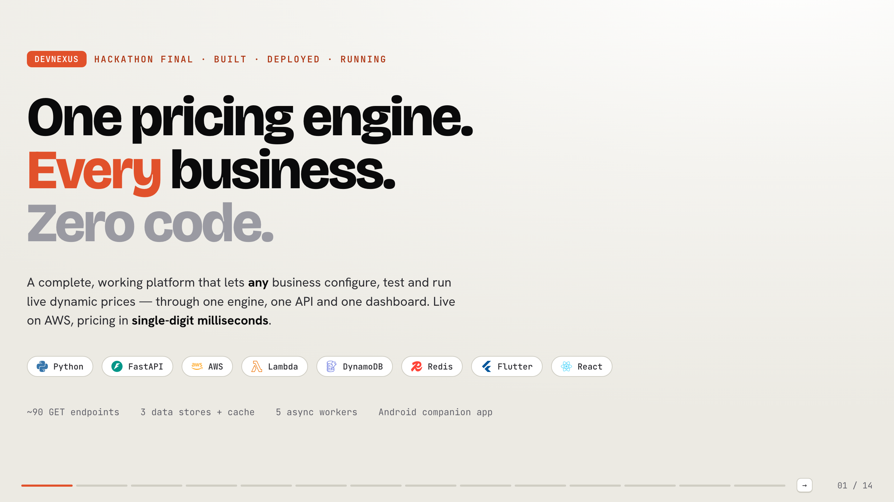
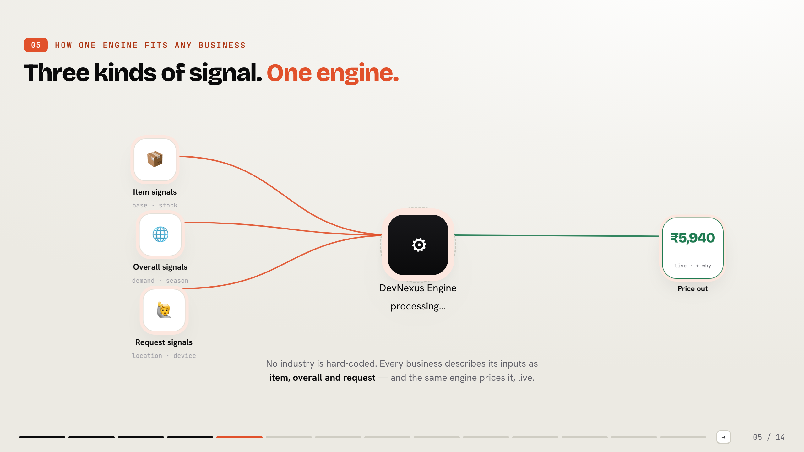
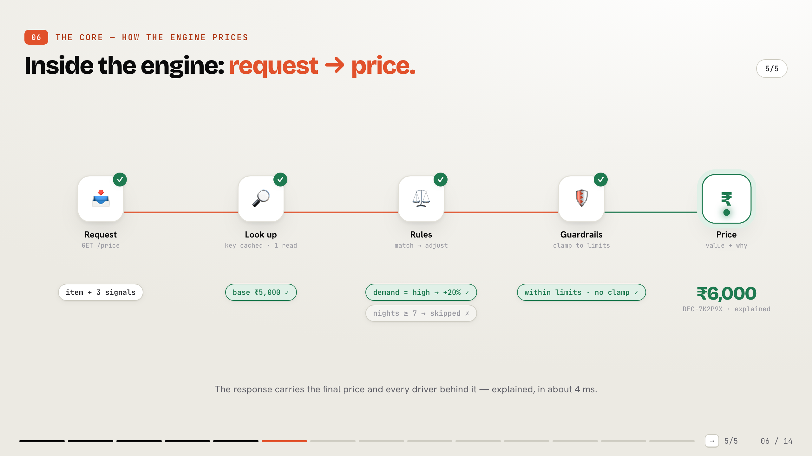
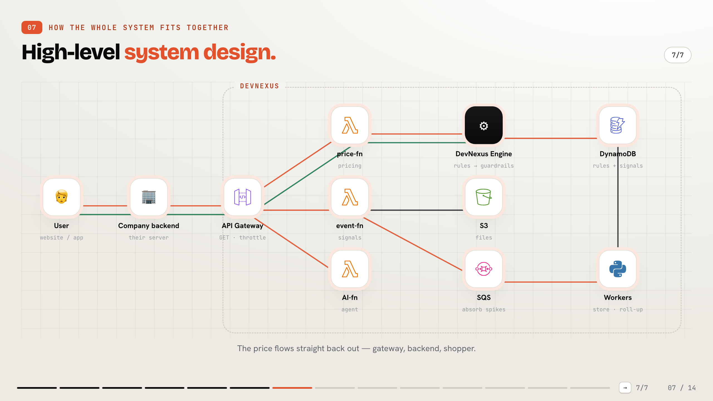
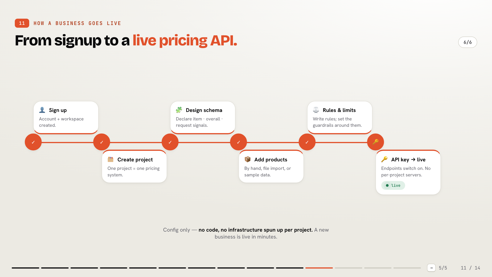
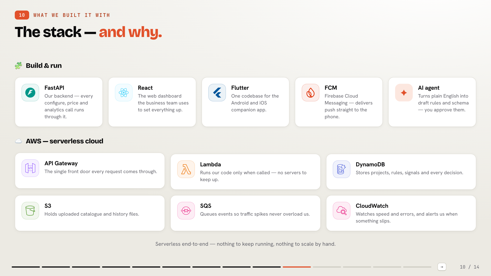

<div align="center">



# DevNexus — Universal Dynamic Pricing Platform

**One configurable pricing engine for *any* business — no code, live on AWS, pricing in single-digit milliseconds.**

[](https://devnexus-a7z.pages.dev)
[](https://ht1rtpk2jj.execute-api.ap-south-1.amazonaws.com/docs)
[](https://devnexus-deck.pages.dev)

</div>

---

## 🔗 Live links

| What | Link |
|---|---|
| 🖥️ **Console** (web app — configure & operate pricing) | **https://devnexus-a7z.pages.dev** |
| 🔌 **Pricing API** (+ interactive docs at `/docs`) | **https://ht1rtpk2jj.execute-api.ap-south-1.amazonaws.com** |
| 🎞️ **Presentation / pitch deck** | **https://devnexus-deck.pages.dev** |
| 📱 **Android app** | `DevNexus.apk` (release build) |

---

## 💡 The idea

Every industry prices differently — a hotel reads occupancy, a bank reads risk, a store reads stock — yet each one **rebuilds pricing logic from scratch, in code**.

**DevNexus proves one engine can price them all.** The insight: every pricing input in the world is one of **three kinds of signal** —

- 📦 **Item signals** — differ per product *(base price, stock, this room/loan/SKU)*
- 🌐 **Overall signals** — shared by the whole business right now *(demand, season, benchmark rate)*
- 🙋 **Request signals** — arrive with each call *(location, device, risk score)*

Describe a business as item / overall / request, and the engine prices it — **nothing is hard-coded to an industry. A new domain is configuration, not code.**

---

## 🌍 Three live domains, one engine

| Domain | What it prices | Example drivers |
|---|---|---|
| 🛒 **E-commerce** | product price | inventory · demand · flash sale · competitor gap |
| 🏦 **Banking** | loan interest rate (APR) | credit score · repo rate · LTV · relationship tier |
| 🚗 **Ride** | ride fare | surge demand · driver supply · distance · rider tier |

All three run on the **same deterministic engine** — the "one engine, many domains" requirement, demonstrated live.

---

## 🧩 How one engine fits any business



## ⚙️ Inside the engine — one request → a price



**Request → check the item exists → look up (cache + one DB read) → apply rules → clamp to guardrails → return price + explanation.**
The engine is a **pure, deterministic function** — same inputs always give the same price, which makes simulation, back-testing and "replay this decision" honest, not approximate.

## 🏗️ High-level system design (AWS)



A customer's backend calls DevNexus → **API Gateway** → **Lambda** → the **DevNexus engine** (fed rules + signals from **DynamoDB**) → the price flows straight back out.

## 🪜 From signup to a live pricing API



A business goes live in minutes: sign up → create project → design schema → add products → rules & limits → **API key is live**. Routes are static — **no infrastructure is spun up per project**, so creation is instant.

## 🧱 Tech stack



- ⚙️ **Backend:** Python + **FastAPI** (control plane)
- ☁️ **AWS (serverless):** API Gateway · Lambda · DynamoDB · S3 · SQS · CloudWatch · SSM (secrets) · in-memory cache on the hot path
- 📱 **App:** **Flutter** (Android/iOS) + **FCM** push
- ⚛️ **Web:** **React** console
- ✦ **AI:** an agent that turns plain English into draft config *(drafts only — the engine stays deterministic)*

---

## 🚀 Why it's fast (≈ 4 ms p50)

- 🪶 A dedicated **hot-path Lambda** with no web framework → minimal cold start
- 🎯 **One `BatchGetItem`** — strategy + global signals + item, in a single round trip
- 🧠 **In-memory cache** for the API-key lookup; clients reused across calls
- ➗ **Pure in-memory engine** — zero I/O during the calculation
- 📮 Decision record written **asynchronously after replying**
- 🚨 Measured via `X-Response-Time` + CloudWatch, with a **p99 alarm at 150 ms**

---

## 🛡️ Reliability & control

**Deterministic · Explainable · Auditable · Conflict-checked · Versioned + rollback · Human approval · Safe fallback (never returns an error).**

---

## 🗂️ Repository structure

```
DevNexus/
├── backend/              # FastAPI control plane + pricing engine + async workers
├── frontend/             # React console (devnexus-a7z.pages.dev)
├── android/              # Flutter companion app (Android / iOS)
├── presentation/         # React pitch deck (devnexus-deck.pages.dev)
├── real-time-simulation/ # Cloudflare Workers demo sites that drive the live API
├── infra/                # CloudFormation / SAM — all AWS resources
├── scripts/              # deploy, seed, test suites
├── docs/images/          # architecture screenshots (this README)
├── ARCHITECTURE.md       # system design + full API specification
└── RESEARCH.md           # industry research, abstraction, assumptions & limitations
```

---

## 📦 Deliverables

- 📚 **Research & analysis** → [`RESEARCH.md`](RESEARCH.md) — 3 industries, common patterns, the abstraction, assumptions & limitations
- 🏛️ **Architecture & API spec** → [`ARCHITECTURE.md`](ARCHITECTURE.md)
- 🧪 **Working prototype** → the live console + API (links above)
- 🌍 **Three domain demos** → E-commerce · Banking · Ride (live)
- 🔌 **Pricing API** → `GET /v1/p/{key}/price` (docs at `/docs`)

---

## 🛠️ Run locally (quick)

```bash
# Console
cd frontend && npm install && npm run dev

# Presentation
cd presentation && npm install && npm run dev

# Backend deploy (needs AWS creds + secrets in .secrets/)
./scripts/deploy.sh dev ap-south-1
```

> Secrets (Gemini keys, Firebase service account, `google-services.json`) are **git-ignored** and live only in `.secrets/` — the deployed system reads them from AWS SSM at runtime.

---

## 👥 Team

| Member | Role |
|---|---|
| **Mohammad Sadiq** | Lead · system design · backend · cloud · research · Android |
| **Fazle Moin** | Android app |
| **Owais Aminbhavi** | React web console |
| **Abdul** | React web console |

<div align="center">

**DevNexus — pricing, finally reusable.**

</div>
